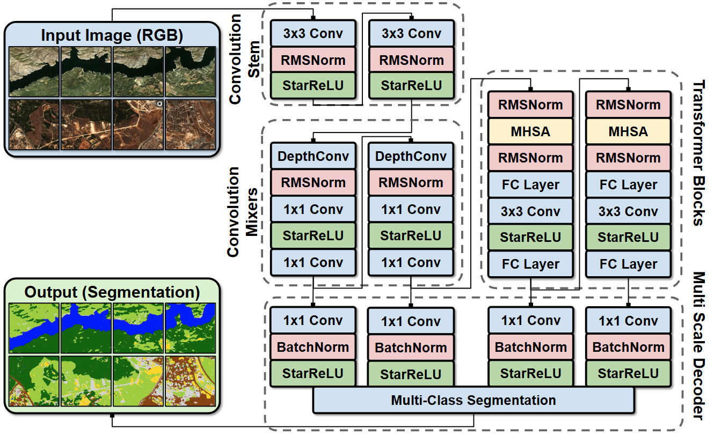

# LALE
This repository contains an end-to-end training and evaluation pipeline for LALE, a lightweight segmentation architecture designed for high-performance remote sensing image analysis.



# NanoRSFormer Training Pipeline

This repository contains an end-to-end training and evaluation pipeline for **NanoRSFormer**, a lightweight segmentation architecture designed for high-performance remote sensing image analysis.

---

## Overview

The architecture implements a bifurcated encoder strategy—utilizing **ConvMixer blocks** for high-resolution local features and **Transformer blocks** for global context—to achieve an optimal balance between parameter efficiency and segmentation accuracy.

### Key Features

* **Custom Efficient Blocks:** Incorporates `RMSNorm` and `StarReLU` for improved training stability and reduced computational overhead.
* **Memory-Efficient Data Loading:** Leverages Hugging Face `datasets` with optimized `DataLoader` settings (`persistent_workers`, `prefetch_factor`) for high-throughput training.
* **Fast Mask Preprocessing:** Utilizes bitwise LUT (Look-Up Table) operations for near-instantaneous conversion of RGB segmentation masks into class indices.
* **In-Loop Tracking:** Integrated `ConfusionMatrixTracker` calculates IoU, F1, and Precision/Recall metrics on-the-fly without the need for massive memory allocation.
* **WandB Integration:** Automatic experiment logging, including per-class metrics and visual sanity-check overlays.

---

## Installation & Requirements

The pipeline relies on `torch`, `torchvision`, `albumentations`, `segmentation-models-pytorch`, and `wandb`.

```bash
pip install torch torchvision albumentations segmentation-models-pytorch wandb datasets

```

---

## Usage

### Training the Model

To start a training run, simply execute the script:

```bash
python RS_train.py

```

### Command Line Arguments

* `--architecture`: Specify the model architecture name (default: "LALE").
* `--no-save`: A flag to disable the local saving/loading of the `.pth` model weights.

---

## Pipeline Components

| Component | Functionality |
| --- | --- |
| `NanoRSFormer` | The core model architecture (Stem → Bifurcated Encoder → MLP Decoder). |
| `HFSegmentationDataset` | Handles streaming/local caching of remote sensing data and applying `albumentations`. |
| `Trainer` | Manages the training loop with `Automatic Mixed Precision (AMP)` and gradient clipping. |
| `ConfusionMatrixTracker` | Compute heavy segmentation metrics in a memory-efficient manner. |
| `upload_sanity_checks` | Logs visual predictions vs. ground truth to W&B for qualitative assessment. |

---

## Configuration

Training hyperparameters are defined in `config_dict`. You can modify these settings directly in the script:

* **Dataset:** Any segmentation dataset with RGB images in "image" and segmentation maps in "conditioning_image" column.
* **Optimization:** `AdamW` optimizer with `ReduceLROnPlateau` scheduler.
* **Compute:** Supports `bfloat16` autocasting and `torch.compile` for accelerated execution on supported GPUs.

---
## Results

Our comprehensive model benchmarking, architecture search, and ablation studies on the ARAS400k and LiTS datasets, totaling over 200 individual experiments, were successfully completed in under 400 GPU-hours (NVIDIA H100), demonstrating highly efficient training. Training a LALE model requires an average of just 2.5 hours, while inference takes only 11 minutes for 100,240 remote sensing images. This covers an area of 657,000 km square,

### Comprehensive performance and efficiency comparison of segmentation architectures (Performance values in %)

| Architecture | F1 | Accuracy | Precision | Recall | IoU | Size (MB) | Params (M) | GMACs |
| --- | --- | --- | --- | --- | --- | --- | --- | --- |
| DeepLabV3 | 75.23 | 84.22 | 76.00 | 74.58 | 63.01 | 28.04 | 7.3 | 6.44 |
| DeepLabV3+ | 76.37 | 84.94 | 77.34 | 75.48 | 64.30 | 18.90 | 4.9 | 1.46 |
| FPN | 76.38 | 85.00 | 76.68 | 76.14 | 64.35 | 22.13 | 5.8 | 2.51 |
| Linknet | 75.45 | 84.09 | 76.21 | 74.76 | 63.21 | 16.06 | 4.2 | 0.58 |
| PAN | 76.12 | 84.57 | 76.18 | 76.14 | 63.93 | 15.80 | 4.1 | 0.98 |
| Unet | 77.23 | 85.09 | 77.13 | 77.53 | 65.28 | 24.02 | 6.3 | 3.05 |
| UnetPlusPlus | 76.86 | 85.00 | 77.17 | 76.60 | 64.90 | 25.24 | 6.6 | 5.62 |
| UPerNet | 77.31 | 85.53 | 77.83 | 76.84 | 65.42 | 44.49 | 11.6 | 13.62 |
| Segformer | 76.47 | 84.82 | 76.05 | 77.10 | 64.44 | 17.23 | 4.5 | 2.05 |
| **LALE-S1** | 74.69 | 83.16 | 75.18 | 74.26 | 62.25 | 5.98 | 1.6 | 0.59 |
| **LALE-S2** | 75.88 | 84.12 | 76.39 | 75.42 | 63.67 | 9.97 | 2.6 | 0.78 |
| EffFormer-L1 | 74.24 | 83.13 | 73.33 | 75.64 | 61.81 | 113.97 | 29.8 | 23.17 |
| EffFormer-L3 | 75.23 | 83.96 | 73.83 | 77.17 | 62.97 | 187.75 | 49.1 | 25.85 |
| EffFormer-L7 | 75.35 | 84.00 | 74.36 | 76.89 | 63.13 | 383.22 | 100.3 | 32.16 |
| DeiT3-Base | 76.10 | 84.53 | 75.63 | 76.74 | 63.97 | 446.64 | 117.1 | 39.89 |
| MaxViT-Tiny | 75.82 | 84.46 | 75.55 | 76.24 | 63.64 | 232.26 | 60.8 | 33.13 |
| FastViT-SA12 | 74.71 | 83.36 | 74.29 | 75.32 | 62.32 | 111.71 | 29.2 | 23.40 |
| FastViT-MCI0 | 75.53 | 83.96 | 74.53 | 76.96 | 63.33 | 111.11 | 29.1 | 23.75 |


